# 🎓 PNU Gate
### Project Management & UI/UX Prototyping

**Academic Project | IS 350 – Project Management**  
**Princess Nourah bint Abdulrahman University**

## 📌 Overview

PNU Gate is a proposed enhancement to the university's student application, designed to improve students' academic and administrative experiences through a unified digital platform.

The project focused on applying project management methodologies, developing comprehensive project documentation, and demonstrating the proposed solution through a Figma prototype.

> This is an academic project management case study and UI/UX prototype, not a fully developed application.

## 🎯 Proposed Features

- Academic schedules and smart class reminders
- QR code-based attendance tracking
- AI-powered academic assistant
- Student–faculty communication
- Grade and absence tracking
- Improved access to university services

## 📋 Project Management Deliverables

- Project Charter
- Stakeholder & Requirements Analysis
- Scope Statement
- Work Breakdown Structure (WBS)
- WBS Dictionary
- RACI Matrix
- Gantt Chart
- Risk Register
- Agile/Scrum Project Planning

## 👩🏻‍💼 My Role & Contributions

**Team Leader | Project Manager | UI/UX Contributor**

- Led the team and coordinated project activities.
- Took primary responsibility for project documentation, planning, and presentation preparation.
- Proposed incorporating UI/UX prototyping to make the project proposal more engaging and easier to understand.
- Contributed to the visual presentation and communication of the proposed solution.
- Helped the team achieve a full grade for the project.

## 🎨 UI/UX Prototype

An interactive design concept was created in Figma to visualize the proposed student experience.

🔗 [Explore the PNU Gate Figma Design](https://www.figma.com/design/SXm08tTweh2M7DvyYToEN1/PNU-Gate?node-id=0-1)

### 📱 UI/UX Prototype Gallery

  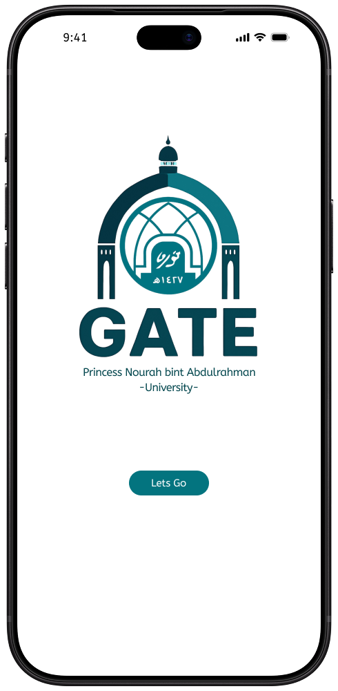
  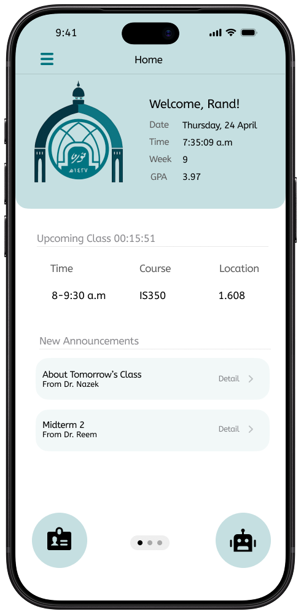
  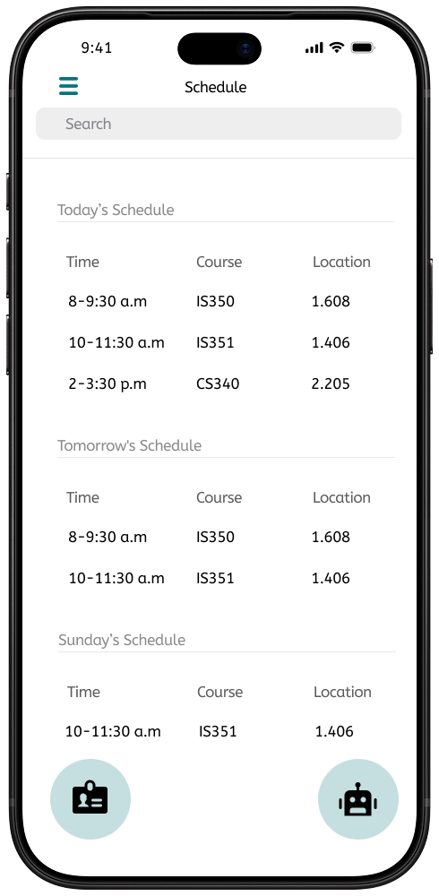

  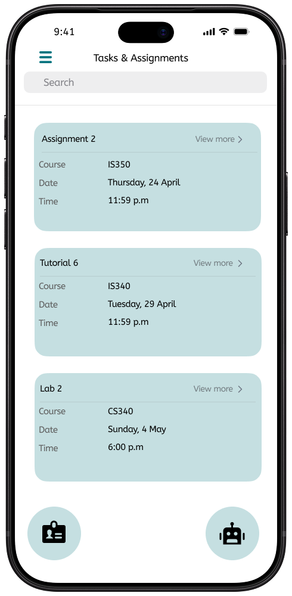
  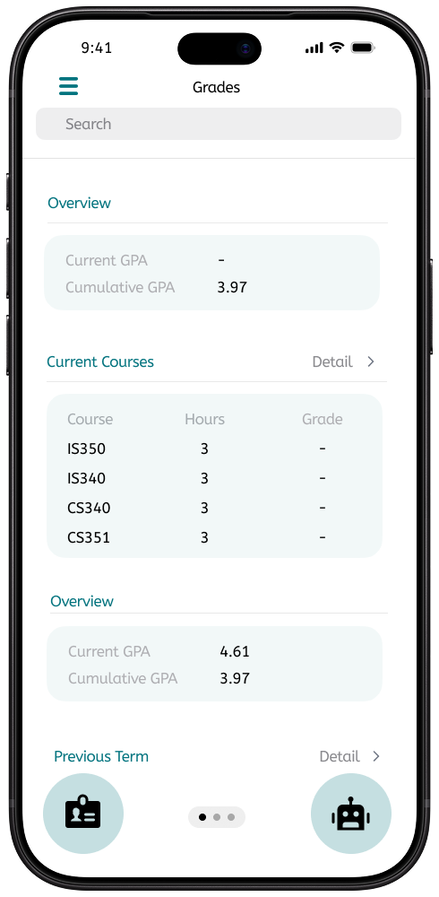
  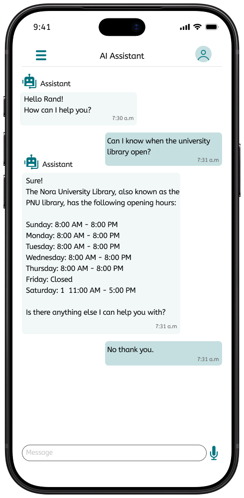

  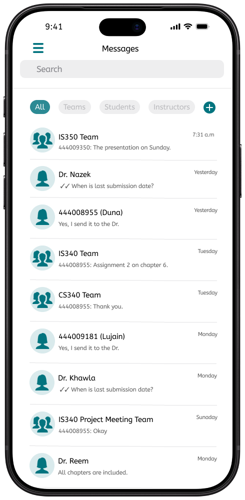
  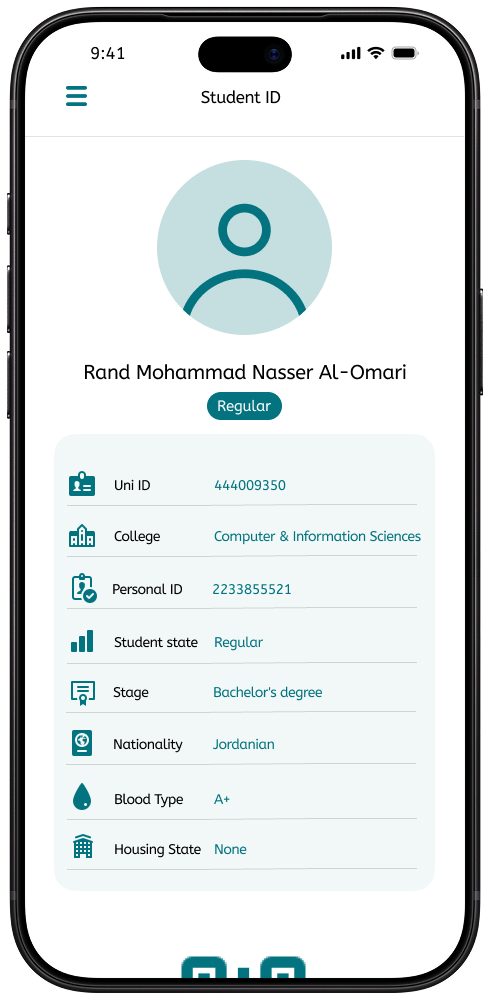

### 📊 Project Management Artifacts

The following artifacts demonstrate the project's
planning, scheduling, team coordination, and
risk management approach.

#### Work Breakdown Structure (WBS)
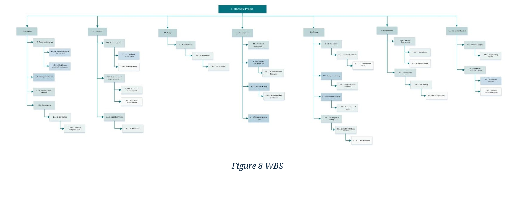

#### Gantt Chart
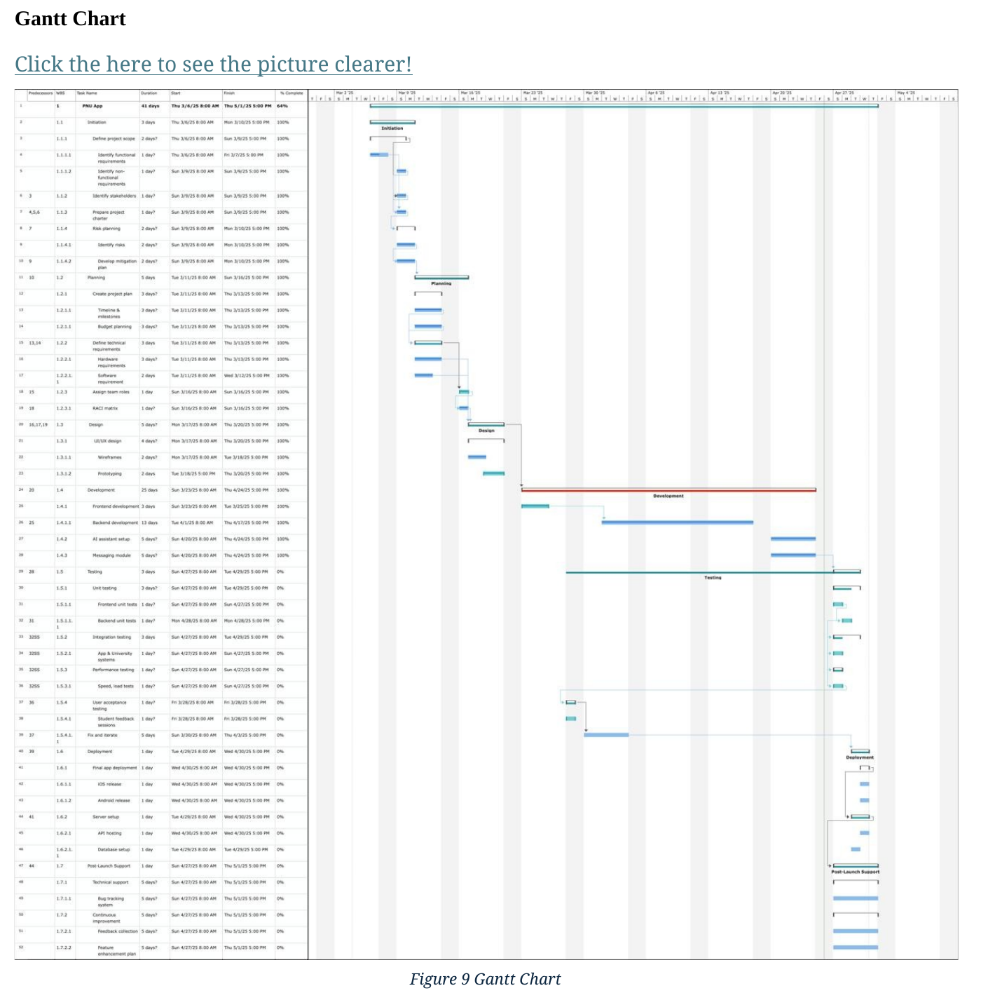

#### RACI Matrix
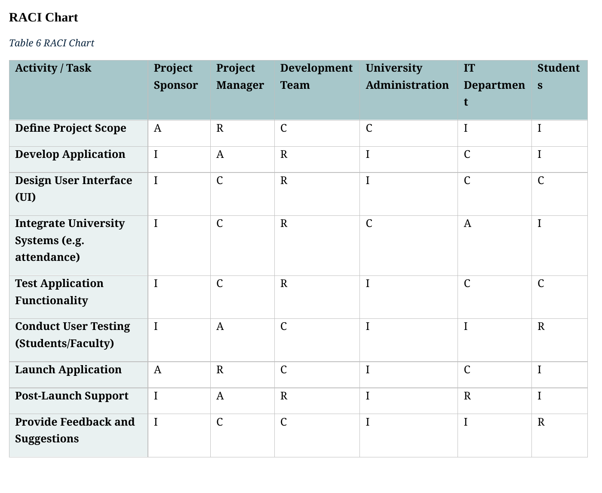

#### Risk Register
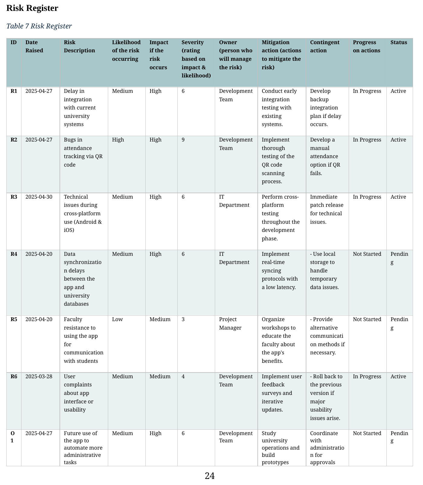

## 🏆 Academic Recognition

The project received full marks. The instructor particularly praised the initiative to incorporate prototyping, the clarity of the presentation, and the team's coordinated delivery.

## 🛠️ Tools & Methodologies

- Figma
- Agile & Scrum
- Project Planning
- Requirements Analysis
- Risk Management
- UI/UX Prototyping

---

**Project Type:** Academic Case Study & Prototype  
**Status:** Completed Academic Project
